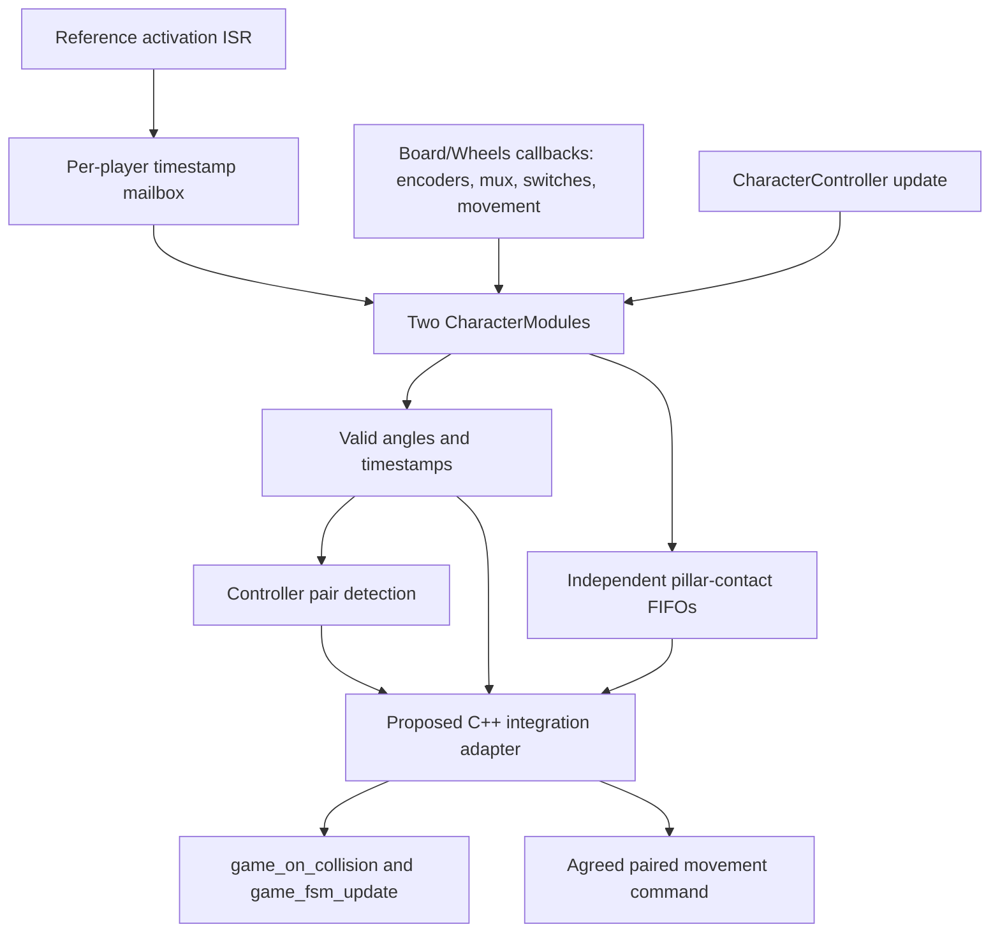

# Crater Crawl — consolidated project handoff

Prepared: November 15, 2026  
Scope: tracking firmware, reference electronics context, Game Logic integration guidance, design-review slides, and subsequent collision-behaviour clarifications.  
Code inspected: local repository HEAD `2d583fa`. The working tree contained the untracked earlier `GAME_LOGIC_HANDOFF.md`; no tracked changes were reported at inspection.

This document is a handoff, not an instruction to deploy code or change hardware. It contains a current summary followed by the complete earlier engineering handoff, including data structures, public functions and an integration example. The appendix's adapter is a proposal, not an implemented connection.

## Current status at a glance

| Area | Implemented / delivered | Still outstanding |
| --- | --- | --- |
| Firmware | C11 CharacterModule and CharacterController, public headers and explanatory comments | Real board drivers and application integration |
| Angles | Independent offsets, direction normalization, validity checks, nonblocking homing and runtime reference refresh | Measured reference timing, encoder conversion/mux ownership, physical testing |
| Pillar contacts | Switch polling, one event per accepted press, stable-release rearming, separate four-event queues | Physical switches/pins, shortest-pulse capture tests, unknown-pillar contract with GL |
| Character encounters | Shortest circular gap, 5° entry / 10° reset hysteresis, event snapshots | Physical threshold tuning and agreed motor interaction policy |
| Movement response | Optional C separation-direction helper; default callbacks unset | Motor blocking, slowdown, continuous contact constraints, force-feedback integration |
| Verification | Host behavioral tests and C-to-C++ linkage test delivered; previously passed | Actual Mega build, memory/timing checks and hardware tests |
| Documentation | Header comments, README, detailed GL handoff and this consolidated handoff | Update measured values after bench testing |
| Presentation | Six tracking slides and speaker notes; three slides later simplified | Add measured hardware results when available |

No new firmware functionality was added during the slideshow work or subsequent explanatory conversation. The discussion did not implement slowdown or motor blocking.

## 1. How the subsystem fits together

There are two persistent `CharacterModule` structs, one per player, and one `CharacterController` holding pointers to them.

- Each module owns that player's reference offset, cached angle, validity, homing state, reference mailbox and pillar-contact queue.
- The controller updates both modules and checks their angular separation.
- Board/Wheels callbacks provide encoder samples, logical switch states, homing movement and interrupt-state handling.
- A still-to-be-written application adapter publishes valid angles and delivers events to Game Logic.
- Game Logic owns lives, alive/lockout state and phase transitions. Wheels executes motor and animation commands.

Tracking remains C11. The existing Game Logic application uses C++; the public tracking headers contain C-linkage guards. Compile the tracking .c files as C and link them with the C++ application. The host Python script only runs tests.

Storage is fixed; there is no dynamic allocation. Config structs are copied, but callback context pointers, pillar tables and player structs must remain alive for as long as they are referenced.

### Essential API usage

| When | Functions / rule |
| --- | --- |
| Setup | Obtain defaults, fill real callbacks/mapping, then call `character_init()` for each player and `character_controller_init()` |
| Initial calibration | Call `character_start_homing()`; success means started, not finished |
| Reference activation interrupt | Call `character_reference_isr()` for the correct player; it records a timestamp only |
| Every main-loop pass | Call `character_controller_update()`; it already updates both modules |
| Read position | Check `character_angle_is_valid()` after updating, then call `character_get_angle()` |
| Consume pillar hits | Repeatedly call `character_read_pillar_collision()` until empty for both players |
| Consume pair event | Call `character_controller_read_collision()`; do not treat it as a pillar hit |
| Optional response | `character_response_separate()` proposes directions; hardware execution and eligibility are external |
| Abort homing | `character_cancel_homing()`; this is not a general gameplay motor-stop function |

**Getter clarification:** `character_get_angle()` returns a cached number even when the current position is invalid. It does not validate freshness or read the encoder. A zero return is not proof of successful calibration. The separate validity check is mandatory.

## 2. Calibration and optical-reference electronics

The optical interrupter marks a known physical position. Continuous position comes from encoder feedback; the implemented approach is not a Gray-code optical disk.

Both players use a common physical zero and positive direction, but each stores an independent encoder offset. Angles are in tenths of a degree: 450 means 45.0°, and one turn is 3600 units.

```text
corrected angle = wrap3600(encoder_sign × (raw angle − reference offset))
Example, positive direction:
reference reading = 5° → save offset 5°
later reading = 50° → corrected angle 45°
```

Initial homing is nonblocking. Updates continue while searching, with a default 10-second timeout. A reference initially blocked must clear before a new activation is accepted. The ISR stores the crossing timestamp; the main loop obtains a sample representing that crossing. A late sample must not be falsely labelled with the earlier timestamp.

After accepting a reference, recalibration stays disarmed until the sensor is clear and the shortest circular distance from zero exceeds 45°. This is a provisional ±45° region around zero. At 359°, the character is only 1° from zero. A later accepted crossing refreshes the offset without restarting homing.

The existing KiCad circuit uses an Everlight ITR9608-F, a 330 Ω LED resistor, a 1 kΩ pull-up, and 5 V / signal / ground connections intended for a Mega. Firmware work did not redesign this circuit or establish measured logic levels. Check that the pull-up and phototransistor produce a reliable digital LOW.

The user specifically identified reference/flag width and rotation direction as testing concerns. The two directions may encounter different edges. Direction-dependent compensation is not implemented. Measure repeatability before choosing compensation or final thresholds.

## 3. Pillar collision handling

An armed switch under a player reports physical contact immediately when observed by the polling update. Neither a valid angle nor a fully extended pillar is required: physical contact during RISING is also reported.

A held press generates one event. The default rearm condition is 20 ms of stable release; an initially held switch is ignored until released under the default startup policy. This release debounce is distinct from GL's post-hit lockout.

Each player has a four-entry FIFO. Reading removes the oldest event. Overflow preserves existing events and increments a diagnostic counter. The event includes time and optional pillar ID. Unknown ID (-1) still means a real contact; GL must agree how to represent it rather than casting it to an unsigned valid pillar index.

Process both players' hit queues before advancing the game FSM so simultaneous fatal contacts can support the intended draw. Drain events even outside active gameplay to prevent old contacts appearing in a later round.

Polling can miss a brief pulse occurring entirely between updates. First-press acceptance is not a filter against every electrical noise pulse. Contact duration, noise, loop timing and simultaneous-hit behaviour need physical tests.

## 4. Character-to-character detection: what 5° and 10° mean

These values are **angular-separation thresholds**, not offsets added to either character's position.

| Condition | Current behaviour |
| --- | --- |
| Both positions calibrated, fresh, valid and sufficiently synchronized | Pair detection may run if enabled by the caller |
| Armed and shortest gap ≤ 5° | Report one pair encounter, then disarm |
| Gap remains ≤ 10° after an encounter | Do not generate another event |
| Gap becomes > 10° | Rearm for the next approach |
| Initial overlap under defaults | Suppress until the characters have separated beyond the reset boundary |
| Invalid data or disabled detection | Reset approach history; apply startup policy on recovery |
| Calibration revision changes | Suppress that update to avoid treating an offset jump as physical approach |

The shortest gap between 358° and 2° is 4°, not 356°.

Example: 12° → 5° triggers one event; oscillating between 4° and 7° generates no additional events; reaching 11° rearms detection. If reset occurred immediately above 5°, fluctuations such as 4.9° → 5.1° → 4.8° could repeatedly report the same encounter. This is why the code uses hysteresis.

The reset need not be exactly 10°; it is provisional. Removing the reset logic entirely without replacing it could leave the detector permanently disarmed after one event. Resetting at the entry boundary instead would invite repeated events near that boundary.

**The 10° condition controls event rearming only. It does not currently command a motor stop, release a motor block, or establish a slowdown zone.**

Discrete angle samples can miss a fast traversal through the detection zone. Tune physical spacing, acquisition rate and relative-speed limits together.

## 5. Collision movement: discussion versus implementation

The behaviour explained in the conversation is a **proposed gameplay policy**, still requiring GL/Wheels agreement and implementation:

- Head-on: prevent both characters from moving farther toward each other; permit either to reverse away.
- Catch-up: prevent the trailing character from driving into the leader; allow the leader to continue away and the trailing character to reverse.
- Separating: allow movement away from the encounter.
- Character-to-character contact should not automatically become a pillar life-loss event.

This is not enforced by the current detector. A proximity event alone cannot stop the motors.

The implemented optional `character_response_separate()` uses relative ordering, incoming directions and observed approach to propose outward directions. It can actively propose opposite directions; that differs from a continuous policy that merely blocks inward commands while respecting user input. It declines some ambiguous or already-separating cases. Its default callbacks are unset, so automatic response is disabled.

No progressive proximity-based slowdown is implemented. An outer slowdown zone was discussed as a possible future feature, with thresholds and speed limits dependent on ring speed, braking distance, latency and character geometry. No numerical slowdown setting was approved or added.

Future motor integration needs one response owner, per-command eligibility and a separate block-release policy. Do not use the event latch as the sole continuous collision constraint: a player could steer back toward the other while the event detector is still disarmed. Pillar death/lockout must take priority over a pair response.

## 6. Integration sequence and remaining work

1. Agree encoder acquisition ownership, gearing conversion, common zero/direction, GPIO polarity and mux/pin mapping.
2. Implement real hardware callbacks, including crossing-time sample acquisition and interrupt-state save/restore.
3. Connect homing movement/stop callbacks and define timeout, retry and invalid-position behaviour.
4. Implement the application adapter: update tracking, publish only valid angles, drain both contact queues, process GL consequences, then handle an eligible pair response and advance the FSM.
5. Resolve unknown pillar IDs and event priority with GL. Consume duplicated per-player pair notifications without issuing multiple responses.
6. Define and implement continuous motor blocking or another approved response with Wheels; add slowdown only if agreed.
7. Compile for the real Mega target and check memory, loop latency and ISR synchronization.
8. Bench-test both rings and then the complete game; replace provisional constants with justified values.

Readiness must be checked at start and countdown completion. Decide what happens if tracking becomes invalid during a round. Motor commands, fault handling and gameplay policy remain integration responsibilities.

## 7. Fall Design Review presentation work

Deck: [Crater Crawl Fall Design Review](https://docs.google.com/presentation/d/1GIWW7XpEhtCznuXYI3sVd0KGzpl1TI_VhinbKK4BuBw/edit)

Six tracking content slides were delivered after the Tracking divider, originally numbered 30–35. Stable slide IDs are preferable to slide numbers if teammates reorder the deck:

| Slide ID | Delivered content |
| --- | --- |
| tracking_review_1 | Tracking Architecture |
| tracking_review_2 | Optical Reference Electronics |
| tracking_review_3 | Angle Calibration |
| tracking_review_4 | Pillar Collision Handling |
| tracking_review_5 | Character-to-Character Detection |
| tracking_review_6 | Validation & Integration Plan |

They use the deck's navy/yellow Raleway style, native editable text/shapes, and speaker notes containing technical detail and optional visual suggestions. The older Gray-code prototype slide was replaced. Other teams' content was left intact.

On November 14, slides 3–5 above were rewritten with a one-sentence purpose, three clear steps, a worked example and a focused next-test statement. The calibration user's additions about direction and flag width were retained. All three revised slides were exported and visually inspected. This describes the delivered edits; it is not a claim that nobody has edited the shared deck since then.

A cross-team discrepancy was documented in notes: the Game Logic pillar slide highlights EXTENDED as the hit state, but Tracking reports actual contact while RISING too. Resolve this contract with GL.

## 8. Verification and files

Primary firmware and test files are listed in the appendix. The prior host test run passed 14 behavioral groups plus a C-to-C++ linkage smoke test. Later comments were checked for unchanged preprocessed code and strict syntax. No new tests were run solely to produce this handoff; no hardware test or target firmware build is claimed.

Run the existing suite from the repository root:
```powershell
python '.\Photo Interrupt Sensor\tests\run_tests.py'
```
Use its compiler-path options when GCC/G++ are not on PATH. The suite uses simulated hardware callbacks; it does not verify real sensor precision or motor response.

The original engineering handoff remains at [GAME_LOGIC_HANDOFF.md](GAME_LOGIC_HANDOFF.md). The full text is included below so this file can be handed to another developer on its own. Its relative repository links assume this file stays in the Photo Interrupt Sensor folder.

---

# Appendix — complete engineering reference

The following reference was prepared November 8, 2026. It describes the same inspected firmware snapshot. Its adapter example and policy recommendations remain proposed integration work. References to previously passing tests are historical; no additional test run is implied. The current summary above adds the slideshow work and clarifies the later blocking/slowdown discussion.


# Crater Crawl tracking: code and game-logic handoff

**Prepared:** November 8, 2026  
**Source snapshot:** local repository HEAD `2d583fa`  
**Audience:** Game Logic (GL), Tracking (T|E), and Wheels (W|E)

This document explains the implemented C tracking subsystem and how GL can integrate it. Descriptions of existing functions are current behavior. The adapter example and policy recommendations are proposals, not code already connected to the game. Read this document with the source files; it is an engineering handoff, not an instruction to change or deploy the project automatically.

## 1. Start here

There are **two `CharacterModule` instances, one per player, and one `CharacterController` that coordinates them**. Each module maintains its own encoder offset, angle validity, homing state and pillar-switch events. The controller updates both modules and detects player-to-player proximity.

The normal entry point is `character_controller_update()`, called once per main-loop pass. Afterward, an adapter publishes valid angles, drains pillar contacts into `game_on_collision()`, handles the separate pair event, and advances the game FSM.

Three different physical/logic mechanisms must remain distinct:

| Mechanism | Source | Meaning | Recipient |
| --- | --- | --- | --- |
| Reference crossing | Photo-interrupt activation | Establish/refresh encoder zero | Tracking calibration |
| Pillar contact | Limit switch under a player | An actual pillar hit occurred | GL's pillar-hit/life logic |
| Player-pair encounter | Circular separation of both valid angles | Players entered the configured proximity zone | Agreed direction-response policy |

**The photo-interrupt sensor is a reference, not the player-to-player collision detector. A pillar switch press is a hit without waiting for an angle or an extended-pillar state.**

### Implemented and still outstanding

| Implemented | Still to implement or confirm |
| --- | --- |
| C structs, configuration validation and public functions | Actual player-to-pin and mux-channel mapping |
| Independent angle offsets and validity | Encoder/mux driver and acquisition owner |
| Nonblocking homing state and timeout | Wheels homing movement and stop callbacks |
| Interrupt event mailbox and reference-sample checks | Interrupt attachment and crossing-time sampling/reconstruction |
| Periodic reference rearming buffer | Physical polarity, timing and threshold measurements |
| Switch debounce, contact FIFO and optional pillar attribution | Measured pillar-position table or direct wiring attribution |
| Pair detection, latching and optional separation policy | Team-approved direction/lockout/startup policies |
| Host tests and C-to-C++ linkage check | GL adapter, real main-loop integration and hardware validation |

No GPIO pins or mux channels have been invented in the production code. Callback interfaces are implemented; the real board callback bodies are not.

## 2. File map

Paths below are relative to this document's folder.

| File | Purpose |
| --- | --- |
| [CharacterModule.h](CharacterModule.h) | One-player data structures, hardware callback contract and public API |
| [CharacterModule.c](CharacterModule.c) | Homing, encoder offsets, reference events, switch debounce and event storage |
| [CharacterController.h](CharacterController.h) | Pair data structures, response callbacks and integration guidance |
| [CharacterController.c](CharacterController.c) | Update both players, compare positions, latch encounters and optionally request movement |
| [README.md](README.md) | Shorter operational notes and tuning defaults |
| [tests/test_tracking.c](tests/test_tracking.c) | Fake hardware and 14 behavioral test groups |
| [tests/cpp_link_smoke.cpp](tests/cpp_link_smoke.cpp) | C++ caller linked against separately compiled C objects |
| [tests/run_tests.py](tests/run_tests.py) | Host build and test runner |
| [../.vscode/c_cpp_properties.json](../.vscode/c_cpp_properties.json) | Added Windows GCC IntelliSense configuration; macOS configuration preserved |

Relevant existing GL files are [../shared_state.h](../shared_state.h), [../game_fsm.h](../game_fsm.h), [../game_fsm.cpp](../game_fsm.cpp), [../main.cpp](../main.cpp), [../console.cpp](../console.cpp), and [../sequencer.cpp](../sequencer.cpp). Tracking has not been connected to them.

The KiCad schematic/project/PCB in this folder describe the reference electronics. They are not executable firmware and do not supply a board pin mapping. This firmware work did not change them.

## 3. Architecture and ownership



The recommended adapter is C++ because the existing GL headers use C++ enums, structs and references. The tracking implementation stays C11. Its headers use `extern "C"` guards so C++ callers link to the C functions correctly. Do not include `shared_state.h` inside the tracking `.c` files.

| Data/action | Writer or owner | Integration rule |
| --- | --- | --- |
| `CharacterModule` internal state | Tracking functions; reference ISR writes only its mailbox | GL reads diagnostics and calls the API; it does not edit latches/offsets |
| `g_state.players[i].angle_x10` | Tracking's agreed publication path | Publish through one adapter path only, after validity checks |
| `alive`, `locked_out`, `lockout_started_ms` | GL | Tracking must not change them |
| Lives and phase transitions | GL | Keep decisions in `game_on_collision()` / game FSM |
| Raw encoder acquisition and mux | Board/Wheels adapter; owner needs agreement | Both normal and reference reads use the same source and channel |
| GPIO polarity/interrupt attachment | Board adapter | Return logical active/pressed states to C code |
| Pair movement decision | One selected owner: GL or controller callback route | Do not apply both routes |
| Motor command execution | Wheels/board adapter | Honor fatal-hit/lockout interlocks and handle command failures |

The controller does not publish `g_state`, call GL, or consume pillar queues. Those are adapter responsibilities.

## 4. Units, pointers, storage and time

- Angles are unsigned tenths of a degree: `450 = 45.0 degrees`, `3599 = 359.9 degrees`. A full turn is `3600`; valid positions are `0..3599`.
- Both players must describe the same physical zero and positive direction. `encoder_sign` is `+1` or `-1` to correct an encoder's direction convention. Counts, gearing and motor-to-ring conversion belong in the adapter before returning an angle.
- Player IDs used with GL must be valid `g_state.players[]` indexes, currently `0` and `1`. The standalone module does not enforce GL's player count; the adapter must.
- `now_ms`, sample timestamps and crossing timestamps use the same unsigned 32-bit millisecond clock. Duration arithmetic handles rollover; configured intervals must not exceed `INT32_MAX`, and homing timeout must be nonzero.
- The code uses fixed storage with no dynamic allocation. Initialize objects to zero and check init return values. Do not reinitialize live objects while interrupts/movement are active.
- `&player` passes a pointer to that player's existing state. Functions can update it without copying the entire struct. A `const CharacterModule *` parameter is read-only.
- Configurations are copied by value, but `context` and pillar-table pointers still reference external objects. Those objects must outlive the modules/controller. The controller also stores pointers to the original two modules.
- Except for the reference ISR mailbox, access happens from one main-loop context. Event reads are not designed for concurrent consumers or calls from interrupts.

## 5. Data structures

### `CharacterEncoderSample`: one acquisition

| Field | Meaning |
| --- | --- |
| `angle_x10` | Absolute encoder-derived ring angle, before subtracting the stored reference offset |
| `sampled_ms` | Actual acquisition time, or the represented time of a justified reconstruction |

The normal read must provide a sample at or before the update's `now_ms` and within `max_sample_age_ms`. Failed, future, stale or out-of-range readings cannot update the valid cache. A practical adapter acquires/caches samples first and timestamps the update afterward.

### `PillarCollisionStatus`: one contact

| Field | Meaning |
| --- | --- |
| `id` | Zero-based pillar index; `CHARACTER_UNKNOWN_PILLAR` (`-1`) means unattributed contact |
| `is_hit` | Whether a queued event was returned; check this before using other fields |
| `hit_ms` | Time the polling update first observed the accepted press |

It contains no player ID because it comes from a known player's module. Take the player ID from `module.config.player_id`. Unknown pillar identity does not make `is_hit` false.

### `CharacterCollisionStatus`: one player's pair notification

Contains `is_hit` and `hit_ms`. The controller records one for each player when it detects an encounter. These are two notifications about the **same pair event**, not additional contacts or life-loss events.

### `CharacterHardware`: functions supplied by the board/Wheels adapter

`context` is an opaque pointer passed back to callbacks; it can point to a board configuration, driver state or test fixture. A read's boolean return means **success/failure**, while its output argument contains the reading. A released switch is a successful read with `pressed=false`, not a failed read.

| Callback | Required? | Contract |
| --- | --- | --- |
| `read_encoder(context, channel, sample)` | Yes | Select the configured channel and return a timestamped normalized absolute angle |
| `read_reference_sample(context, channel, crossing_ms, sample)` | Yes | Obtain/reconstruct position near the actual crossing; return false if unavailable |
| `read_reference_active(context, player_id, active)` | Yes | Return logical optical-reference activation, with polarity handled by adapter |
| `read_pillar_pressed(context, player_id, pressed)` | Yes | Return logical contact-switch state |
| `start_homing(context, player_id)` | Yes | Request controlled movement; true means request accepted, not calibration complete |
| `stop_homing(context, player_id)` | Yes | Stop homing movement; no acknowledgement is returned by this interface |
| `critical_enter(context)` | Yes | Save and disable relevant interrupts; return prior state |
| `critical_exit(context, previous_state)` | Yes | Restore that prior interrupt state |
| `identify_pillar(context, player_id)` | Optional | Return direct wiring attribution, or a negative value if unknown |

No encoder/mux callback runs from `character_reference_isr()`. Critical sections protect only the small timestamp/flag copy. No-op critical callbacks in host tests are not suitable for the Mega's ISR-shared mailbox. Hardware callbacks must have bounded execution time; the core's nonblocking structure cannot compensate for a blocking callback.

The direct pillar callback's nonnegative result is trusted by the module. The adapter must still check it against `NUM_PILLARS` before constructing GL's event.

### `CharacterConfig`: one player's settings

| Fields | Meaning / initial value |
| --- | --- |
| `player_id`, `encoder_channel` | Actual player and mux mapping; both default to zero and must be explicitly configured |
| `encoder_sign` | `+1` by default; only `+1` and `-1` are valid |
| `reference_rearm_x10` | `450`: require distance strictly greater than 45 degrees from zero |
| `release_debounce_ms` | `20`: require a stable released switch interval |
| `homing_timeout_ms` | `10000`: stop unsuccessful homing after 10 seconds |
| `max_sample_age_ms` | `20`: maximum normal encoder sample age |
| `reference_sample_tolerance_ms` | `2`: allowed timestamp difference between reference sample and crossing |
| `max_reference_event_age_ms` | `20`: maximum age of crossing and its reference sample when processed |
| `accept_initial_press` | `false`: require release before accepting an initially pressed switch |
| `pillar_angles_x10`, `pillar_count` | Optional persistent measured-position array and length; default is no table |
| `pillar_tolerance_x10` | Match tolerance; default zero means exact match if a table is supplied |
| `hardware` | Callback structure described above |

All numeric timing/threshold defaults are provisional. Reference-rearm and pillar-match angles must be below half a turn. Init validates each configured pillar-table angle and requires a table pointer when its count is nonzero.

### `CharacterCalibrationState`: progress of homing

| Value | Meaning |
| --- | --- |
| `CHARACTER_UNCALIBRATED` | No currently accepted calibration state; initial/cancelled state |
| `CHARACTER_HOMING` | Movement requested; updates are seeking a valid reference |
| `CHARACTER_READY` | An offset was established; current angle validity is still checked separately |
| `CHARACTER_HOMING_TIMEOUT` | Homing exceeded timeout; stop requested |
| `CHARACTER_HOMING_FAILED` | Reference input or homing-start failure; explicit retry/abort needed |

Encoder/sample failures during homing prevent a valid reference/angle; they do not necessarily immediately change the calibration enum to FAILED. The ongoing homing attempt can eventually time out. There is no automatic retry.

### `CharacterModule`: persistent state for one player

These fields are public to allow allocation and diagnostics, not to invite external mutation.

| Fields | Role |
| --- | --- |
| `config`, `initialized` | Stored configuration and successful-init marker |
| `calibration`, `homing_started_ms` | Homing state and timeout origin |
| `angle_x10`, `reference_offset_x10`, `sampled_ms` | Cached corrected angle, absolute zero reading, and timestamp of last valid angle sample |
| `angle_valid` | Whether the most recent update supplied a usable calibrated position |
| `encoder_error` | Latest normal encoder read failed validation or acquisition |
| `reference_input_error`, `pillar_input_error` | Latest logical input read failures |
| `calibration_revision` | Incremented on every accepted reference; lets controller detect offset jumps |
| `rejected_reference_events` | Armed reference events rejected by timing/sample checks; not a count of all ignored edges |
| `reference_armed` | Whether a reference event is currently eligible for acceptance |
| `reference_pending`, `reference_crossing_ms` | Volatile first-edge ISR mailbox |
| `switch_seen`, `switch_armed` | Startup handling and whether a new press can count |
| `release_timing`, `release_started_ms` | Stable-release timer for debounce |
| `pillar_events[4]`, `pillar_head`, `pillar_count` | Fixed FIFO: oldest pending contact index and count |
| `character_event` | One pending per-player pair notification |
| `dropped_pillar_events`, `dropped_character_events` | Overflow diagnostics; oldest unread events are retained |

Do not confuse `module.pillar_count` (number of queued contacts) with `module.config.pillar_count` (number of measured pillar positions).

### Pair structures

`CharacterDirection` uses `CHARACTER_NEGATIVE=-1`, `CHARACTER_STOPPED=0`, and `CHARACTER_POSITIVE=1`. Positive means increasing shared angle; it is not inherently a particular motor voltage or clockwise wiring convention.

`CharacterPairCollision` contains:

| Fields | Meaning |
| --- | --- |
| `is_hit`, `hit_ms` | New pair event flag and detection time |
| `player_id[2]`, `angle_x10[2]` | Both players' IDs and positions at detection |
| `separation_x10` | Shortest unsigned circular distance |
| `signed_gap_x10` | Shortest signed angle from controller slot 0 to slot 1 |
| `previous_signed_gap_x10` | Previous valid ordering, or zero if no baseline |
| `approach_known`, `approaching` | Whether a baseline exists and separation decreased since it |
| `directions_valid`, `incoming[2]` | Whether both direction reads succeeded, and their captured values |

Array positions are controller slots; use `player_id[]` to identify the actual players. Incoming directions are collected before any response. Do not use them when `directions_valid=false`.

`CharacterControllerConfig` contains `enter_x10=50`, `release_x10=100`, `max_pair_sample_skew_ms=5`, and `detect_initial_overlap=false`, plus a callback `context` and:

- `read_direction`: optional for detection, needed for direction-aware response. Return false when unavailable.
- `choose_response`: optional policy that receives the pair snapshot and fills two outgoing directions. False means no response. Default is NULL.
- `apply_response`: executes one paired movement request. Required, along with `read_direction`, if `choose_response` is configured. Default is NULL. It has no return acknowledgement; the adapter must handle transport faults.

`CharacterController` stores pointers to the two modules, a copied config, `initialized`, `pair_valid`, `baseline_seen`, `armed`, previous gap/separation, both previous `calibration_revision` values, a single `pending_event`, and `dropped_events`. `pair_valid` means the latest angle pair is usable and sufficiently synchronized; it does not imply that gameplay or pair collisions are enabled.

## 6. Public function reference: when GL calls what

Arguments abbreviated as `player`/`controller` below are pointers. Full declarations are in the headers.

| Function | When/caller | Effect and result |
| --- | --- | --- |
| `character_default_config()` | Setup | Returns provisional settings; fill in hardware/mapping before init |
| `character_init(player, config)` | Setup, before ISR attachment | Validates and clears state; true on success; no hardware I/O; invalid config leaves destination unchanged |
| `character_start_homing(player, now_ms)` | Explicit initial home/retry | Invalidates old position and requests movement; true means started, not finished; false on missing init, already homing, input/start failure |
| `character_cancel_homing(player)` | Abort active homing | Requests stop and marks uncalibrated; does nothing outside HOMING; not a generic gameplay motor stop |
| `character_reference_isr(player, crossing_ms)` | Board's reference activation ISR | Records the first pending crossing timestamp; no encoder read |
| `character_update(player, now_ms)` | Each loop, normally called by controller | Processes calibration, position, rearm and switch contact for one player |
| `character_get_angle(player)` | After update, with validity check | Returns cached tenths of a degree; does not acquire a sample |
| `character_is_calibrated(player)` | Readiness/diagnostics | True only in READY; can remain true through encoder-read failure |
| `character_angle_is_valid(player)` | Before using/publishing position | True when calibrated and latest update supplied a valid sample; getter itself does not advance time |
| `character_read_pillar_collision(player)` | Drain each main-loop pass | Pops oldest contact; returns `is_hit=false` when empty |
| `character_read_character_collision(player)` | Consume each pass if using or discarding per-player notifications | Clears one pending pair notification; does not move a motor |
| `character_record_character_collision(player, now_ms)` | Controller internally | Records one per-player notification; GL normally should not call it |
| `character_angular_distance(a, b)` | Pure calculation if needed | Shortest distance in tenths; inputs must already be in `0..3599` |
| `character_controller_default_config()` | Setup | Returns pair thresholds and disabled automatic response |
| `character_controller_init(controller, first, second, config)` | After both module inits | Binds distinct initialized players with different IDs; validates thresholds/callbacks; true on success; does not home them |
| `character_controller_update(controller, now_ms, enabled)` | Once per loop | Updates both modules and optionally detects/responds to pair encounters |
| `character_controller_read_collision(controller)` | Each loop | Consumes full pair event; check `is_hit` |
| `character_response_separate(context, event, outgoing)` | Optional selected response policy | True fills both directions; false declines; does not command motors; built-in policy ignores context |

Do not call the module updates in addition to the controller update in the same pass. Do not repeatedly call init to reset a round; that destroys calibration/state and is unsafe with live ISR bindings. Use explicit lifecycle handling described below.

## 7. How calibration and tracking work

### Initial homing

1. Start with initialized hardware and module state, then attach the reference activation interrupt to the correct player.
2. Call `character_start_homing()`. It clears an old pending reference and invalidates the previous angle state.
3. If the reference is already blocked, wait for an observed clear state followed by a fresh activation. The current blocked position is not assumed to be zero.
4. Continue controller updates. The ISR records a crossing; the main loop obtains its corresponding encoder sample.
5. Accept only if the event/sample ages and crossing-time difference meet configured limits and the angle is in range.
6. Store that absolute reading as the player's offset, set READY, increment the revision, disarm reference acceptance, and request homing stop.
7. The normal encoder read in that update determines whether a current corrected angle is also valid. READY alone is insufficient to start gameplay.

Successful `start_homing()` does not wait for these steps. Timeout is checked by updates; a blocked main loop cannot enforce it on time. Reference input failure during homing requests stop immediately. GL/Wheels chooses whether to home players sequentially or concurrently and how to handle mechanical constraints.

### Corrected angle

```text
angle_x10 = wrap3600(encoder_sign * (raw_angle_x10 - reference_offset_x10))
```

Example with sign `+1`: physical zero is encountered while raw reading is `50` (5 degrees). Save offset `50`. A later raw reading `500` becomes `450` (45 degrees). A raw reading `40` becomes `3590`, not a negative position. Absolute readings are never repeatedly accumulated.

### Periodic reference refresh

After an accepted reference, new activations are ignored until the sensor is clear and circular distance from zero is strictly greater than the rearm buffer. With default `450`, exactly 45 degrees is still inside; 359 degrees is only 1 degree from zero. On the next eligible crossing, replace the offset. Runtime refresh does not stop normal movement.

Reference direction/finite flag-width correction is deferred. This implementation treats the reference as a point. Refreshing the offset does not correct all possible encoder nonlinearities between passes.

### Timing and ISR boundary

`character_reference_isr()` is a first-event mailbox, not a queue of every crossing. The first pending timestamp survives bounce; later edges while pending do not overwrite it. The main loop copies/clears it under the supplied interrupt-state save/restore callbacks.

`read_reference_sample()` is the key hardware responsibility. It may use a sufficiently close captured sample or a justified reconstruction from a timestamped sample history. This history/reconstruction is not implemented in the core. Never take a late current reading and label it with the earlier crossing time. The core checks timestamps but cannot detect a dishonest timestamp. A rejected event is consumed; the implementation does not keep retrying that same event while waiting for data to arrive.

If a reference arrives after the caller captured `now_ms`, the age check may reject it as a future event. Design acquisition/servicing timing and test races across millisecond boundaries; do not hide latency by rewriting timestamps. For precision beyond the current millisecond tolerance, evaluate a finer hardware capture strategy as a separate interface change.

## 8. Pillar contact detection and event delivery

The switch algorithm accepts the first observed press while armed, records one event, then disarms. A held press never generates another event. A released sample starts the release timer; another press before the stable interval completes resets that release attempt. The default startup behavior also requires stable release before the first accepted hit. Failed switch reads disarm detection until stable release is observed again.

This method prevents duplicate hits from bounce but does not reject isolated noise pulses. It polls, so it cannot capture a contact entirely between loop passes. Measure the shortest contact and worst loop interval before deployment; if polling is inadequate, edge capture needs an explicit adapter/core design.

Pillar attribution occurs after contact detection:

1. Use a nonnegative direct callback result if available.
2. Otherwise, use the current valid corrected angle and measured pillar table.
3. Require exactly one table entry within tolerance. The array index is the pillar ID.
4. Return `-1` for no unique match or unavailable angle, keeping the hit event.

The FIFO holds four contacts per player. Reads remove oldest first. Overflow retains old events, drops the new event and increments `dropped_pillar_events`. GL must drain both players every loop, including phases where events will be ignored. Timestamp fields report detection time, not delivery time.

### Mapping to the existing GL event

| Tracking source | GL destination |
| --- | --- |
| `player.config.player_id` | `CollisionEvent.player_id` |
| Valid, agreed `PillarCollisionStatus.id` | `CollisionEvent.pillar_id` |
| `PillarCollisionStatus.is_hit` | `CollisionEvent.hit` |
| `PillarCollisionStatus.hit_ms` | `CollisionEvent.timestamp_ms` |
| Current loop time | Second argument of `game_on_collision(ev, now_ms)` |

The module's `-1` does not fit the currently documented GL pillar-ID contract (`uint8_t`, `0..NUM_PILLARS-1`). GL/Tracking must agree an explicit unknown-ID representation or a handler accepting unidentified contacts. Do not silently cast `-1`, invent pillar 0, or lose the hit. The current handler logs an invalid pillar ID but does not reject the hit on that basis; that implementation detail is not an agreed sentinel contract.

`game_on_collision()` already rejects `hit=false`, invalid player IDs, non-RUNNING phases, eliminated players and active lockouts. It increments hits, forms `WheelsTrigger`, and eliminates or starts a lockout. Current `PLAYER_LIVES=1` means every accepted hit is fatal. Nonfatal lockout uses current command/delivery time, not the contact timestamp. Do not duplicate these decisions in Tracking.

The handler deliberately does not gate on pillar phase; a rising pillar can make contact. An older comment in `shared_state.h` says collision detection only tests EXTENDED. That comment conflicts with this contact-based implementation and should be reconciled by GL.

## 9. Pair detection and direction response

For normalized positions, separation is `min(abs(a-b), 3600-abs(a-b))`. Positions `3580` and `20` are `40` apart (4 degrees).

Each controller update first updates both modules. Pair detection then requires enabled gameplay eligibility, two valid angles, and acquisition-time skew within the configured bound. It reports an encounter at separation **<= entry threshold** and rearms only at separation **> release threshold**. Defaults are 5 and 10 degrees; the gap prevents repeated responses while still close.

Initial overlap is suppressed by default until separation beyond the release threshold. The same startup rule applies after invalid/skewed data or disabled detection. Setting `detect_initial_overlap=true` changes all those resumptions, not just power-on behavior.

An observed calibration revision change suppresses pair reporting for that pass. If the corrected positions are still close, they must separate before another report. This avoids a false encounter from an offset jump but can suppress a real coincident encounter. Evaluate that tradeoff physically.

The detector reports zone entry, not proof of physical contact or approach. It can report an encounter while already moving apart; the response policy may decline to act. It also does not sweep the path between samples: two players that traverse the entire zone between updates can be missed. Choose update rate and thresholds against maximum relative speed.

### Select one response route

**Recommended integration proposal: GL owns response after pillar processing.** Keep `choose_response=NULL`, supply `read_direction` if direction-based decisions are needed, consume the full pair event, process any same-loop pillar hits first, and recheck eligibility before sending one paired Wheels command.

**Alternative supported by the code: immediate controller callback.** Supply `read_direction`, `choose_response` and `apply_response`. The latter runs inside `character_controller_update()`, before the caller can drain pillar contacts. Resolve command priority explicitly; never let a later pair command undo a death/lockout command.

The optional `character_response_separate()` proposes directions away from relative positions. It handles head-on approach, requires observed decreasing separation for same-direction catch-up, and declines direction-ordering cases that indicate separation. At coincidence it uses previous ordering; without it, or at ambiguous half-turn ordering, it declines. Missing directions also prevent response. It does not choose speeds, handle motor acknowledgements, or define all game policies. The team must approve/replace it before use.

The pair event and both per-player notifications represent one encounter. Read/discard per-player notifications if the full pair event is authoritative; do not reverse motors three times. A single unread pair event is retained; additional events increment `dropped_events`. With automatic callbacks enabled, a new encounter can still invoke response even when its notification cannot be queued.

## 10. Proposed adapter example: where GL calls the API

This is an **illustrative C++ translation unit**, not an installed integration. It is written against the current headers. Functions prefixed `board_`, `wheels_`, and the two `gl_` policy hooks below need real definitions. The unknown-contact hook must preserve contact semantics and apply the agreed GL handling in the same loop, not merely log or discard it.

The example chooses deferred GL response and a conservative eligibility policy (RUNNING, both alive, neither locked out). That policy is a proposal. `read_direction` still needs configuring even though automatic callbacks are disabled. `gl_choose_pair_response()` may delegate to the provided separation helper if the team adopts that policy.

```cpp
#include "Photo Interrupt Sensor/CharacterController.h"
#include "game_fsm.h"

static_assert(NUM_PLAYERS == 2, "Tracking controller expects two players");
static_assert(ANGLE_MAX_X10 == CHARACTER_TURN_X10, "Angle units must agree");

static CharacterModule tracked[NUM_PLAYERS] = {};
static CharacterController tracking = {};
static bool tracking_initialized = false;

// Proposed external hooks, NOT functions already implemented in this repo.
void board_service_encoder_samples();
uint32_t board_now_ms();
void gl_handle_unattributed_pillar(uint8_t player_id,
                                 const PillarCollisionStatus &hit,
                                 uint32_t now_ms);
bool gl_choose_pair_response(const CharacterPairCollision &event,
                            CharacterDirection outgoing[2]);
void wheels_apply_pair(const uint8_t player_id[2],
                       const CharacterDirection outgoing[2]);

// Call once, with board callbacks and persistent contexts/tables configured.
// Attach reference interrupts only after this returns true.
bool tracking_adapter_init(const CharacterConfig configs[NUM_PLAYERS],
                           CharacterControllerConfig pair_config)
{
    if (tracking_initialized || configs == nullptr) return false;
    for (uint8_t i = 0; i < NUM_PLAYERS; ++i) {
        if (configs[i].player_id != i) return false;
        if (!character_init(&tracked[i], &configs[i])) return false;
    }
    pair_config.choose_response = nullptr; // GL decides after pillar hits.
    pair_config.apply_response = nullptr;
    tracking_initialized = character_controller_init(
        &tracking, &tracked[0], &tracked[1], &pair_config);
    return tracking_initialized;
}

// Platform activation ISR wrappers call this with the correct player/time.
// No encoder reads or GL calls belong in the interrupt wrapper.
void tracking_reference_edge(uint8_t player_id, uint32_t crossing_ms)
{
    if (tracking_initialized && player_id < NUM_PLAYERS)
        character_reference_isr(&tracked[player_id], crossing_ms);
}

// Request players separately so the board/team can choose homing order.
bool tracking_home_player(uint8_t player_id, uint32_t now_ms)
{
    if (!tracking_initialized || player_id >= NUM_PLAYERS
        || g_state.phase != PHASE_IDLE) return false;
    return character_start_homing(&tracked[player_id], now_ms);
}

// A fresh update must precede this check; the getter does not sample time.
bool tracking_ready_for_start()
{
    if (!tracking_initialized) return false;
    for (uint8_t i = 0; i < NUM_PLAYERS; ++i)
        if (!character_angle_is_valid(&tracked[i])) return false;
    return tracking.pair_valid;
}

static bool pair_allowed_by_game()
{
    if (g_state.phase != PHASE_RUNNING) return false;
    for (uint8_t i = 0; i < NUM_PLAYERS; ++i)
        if (!g_state.players[i].alive || g_state.players[i].locked_out)
            return false;
    return true;
}

// One proposed main-loop pass, called regularly in EVERY game phase.
void integrated_loop_once()
{
    board_service_encoder_samples();
    const uint32_t now_ms = board_now_ms();

    if (tracking_initialized) {
        character_controller_update(&tracking, now_ms, pair_allowed_by_game());

        for (uint8_t i = 0; i < NUM_PLAYERS; ++i) {
            if (character_angle_is_valid(&tracked[i]))
                g_state.players[i].angle_x10 = character_get_angle(&tracked[i]);
            // Otherwise cache in g_state stays old. GL needs a separate
            // invalid-position/fault policy; it must not assume it is current.
        }

        // Deliver BOTH players' contacts before advancing the game FSM.
        for (uint8_t i = 0; i < NUM_PLAYERS; ++i) {
            for (;;) {
                const PillarCollisionStatus hit =
                    character_read_pillar_collision(&tracked[i]);
                if (!hit.is_hit) break;
                if (hit.id < 0 || hit.id >= NUM_PILLARS) {
                    gl_handle_unattributed_pillar(i, hit, now_ms);
                } else {
                    CollisionEvent ev = {};
                    ev.player_id = tracked[i].config.player_id;
                    ev.pillar_id = static_cast<uint8_t>(hit.id);
                    ev.hit = true;
                    ev.timestamp_ms = hit.hit_ms;
                    game_on_collision(ev, now_ms);
                }
            }
        }

        const CharacterPairCollision pair =
            character_controller_read_collision(&tracking);
        for (uint8_t i = 0; i < NUM_PLAYERS; ++i)
            (void)character_read_character_collision(&tracked[i]);

        // Pillar processing above may have killed or locked out a player.
        if (pair.is_hit && pair.hit_ms == now_ms && tracking.pair_valid
            && pair.directions_valid && pair_allowed_by_game()) {
            CharacterDirection outgoing[2] = {
                CHARACTER_STOPPED, CHARACTER_STOPPED};
            if (gl_choose_pair_response(pair, outgoing))
                wheels_apply_pair(pair.player_id, outgoing);
        }
    }

    game_fsm_update(now_ms);
    // Laptop driver: console_tick(now_ms) goes after the game update.
}
```

This skeleton rejects stale pair notifications for movement and drains them every pass. It is not a complete fault manager or executable application. The external hooks, physical homing order, validity propagation, reset/start commands, and actual Wheels transport remain integration work.

Existing lockout flags normally settle inside `game_fsm_update()` (and also on pillar delivery). The eligibility check above conservatively observes those flags before that update, so a lockout expiry without a pillar event can delay pair eligibility by one loop. If this matters, agree a GL-owned timing interface; Tracking should not clear lockouts itself.

### Where to place the calls in the existing project

| Existing location | Proposed change |
| --- | --- |
| `main()` / future board `setup()` | Initialize GL and board drivers, create both tracking configs, initialize modules/controller, attach correct reference interrupts, request homing |
| `main.cpp::run_loop_once()` / board `loop()` | Add the tracking/adapter sequence before the existing game FSM update; keep console reporting afterward |
| Start command in `console_handle_line()` or button handler | Request start only after a fresh update confirms readiness; current direct `game_start()` checks no tracking readiness |
| Countdown-to-RUNNING transition | Decide what happens if readiness is lost after start but before the countdown ends; an initial start gate alone is insufficient |
| Reset/abort handler | Stop relevant movement through Wheels, cancel active homing if needed, drain pending events and reset GL under the agreed lifecycle policy |
| `game_on_collision()` | Reuse current life/lockout logic; settle unknown-pillar contract instead of duplicating hit processing |
| `send_wheels_trigger()` | Replace current logging-only behavior with the agreed Wheels transport |

Do not call `game_fsm_update()` once per player, or both inside an adapter and again in the existing loop. One update after both contact deliveries preserves the current draw semantics.

The laptop driver uses `s_now_ms` and advances one pass per simulated millisecond. Simulated hardware callbacks must use that clock, not actual wall-clock `millis()`. Its console currently executes a command before `run_loop_once()`, so a readiness-gated start command needs explicit sequencing/deferment after fresh tracking acquisition.

## 11. Round boundaries and fault policy

Calibration belongs to the physical mechanism and need not automatically be discarded each round. `game_reset()` currently preserves angles, resets player/game state and starts lowering pillars; it does not reset Tracking, clear tracking queues, cancel homing or generally stop player motors.

Recommended lifecycle proposal:

1. Continue tracking updates in all phases; disable pair detection when GL says it is ineligible.
2. Drain pillar events immediately so non-gameplay contacts cannot be replayed during a later RUNNING phase. The existing GL handler rejects them at delivery, not based on a historical phase stored with the event.
3. Consume/discard both pair and per-player notifications at transitions. Disabling detection clears its history/latch on update but does not clear already pending notifications.
4. On reset, explicitly cancel any active homing and apply the agreed Wheels stop behavior. `character_cancel_homing()` only stops HOMING, not normal gameplay movement.
5. Keep a valid offset across rounds if mechanically appropriate; otherwise explicitly rehome. Do not zero or reinitialize structs as a shortcut while ISR bindings are live.
6. Decide whether loss of a valid angle stops movement, delays countdown, or faults/pauses play. The current FSM has no dedicated tracking-fault phase and `SharedState` has no angle-valid field. This requires an agreed GL interface/policy.

Inspect diagnostics without rewriting internal state. Encoder errors prevent valid angles; reference-input errors during normal READY operation can leave angle tracking valid while preventing trustworthy reference updates; switch errors suppress further presses until stable release. These are different failure modes and should not all be interpreted as an angle of zero.

## 12. Worked scenarios

| Scenario | What Tracking does | What GL should do |
| --- | --- | --- |
| Encoder reads 5 degrees at reference, then 50 degrees | Stores offset 50, reports angle 450 | Publish 450 only when valid |
| Player hovers around zero after calibration | Ignores new references until clear and outside buffer | No repeated home request needed |
| Both switches press in one loop | Queues independent contacts with that observation time | Deliver both before advancing FSM; with one-life rules both can be eliminated for a draw |
| Switch remains pressed for 1 second | Produces one event, not one per update | Do not poll `is_hit` as a continuously asserted level |
| Encoder fails while a switch presses | Marks angle invalid, still reports contact, possibly pillar ID -1 | Apply agreed unattributed-hit contract; do not suppress actual contact |
| Players approach across 358/2 degrees | Reports 4-degree separation and one encounter if armed | Consider one paired movement response, not pillar life loss |
| Recalibration jumps a position into the pair zone | Suppresses that pass; requires separation again while close | Recognize this deliberate tradeoff during testing |
| Same-loop pillar and pair event | Both are detectable; default controller does not move motors | Process pillar consequences first, recheck eligibility, then decide pair response |
| No actual Wheels transport connected | Callback/core tests can still pass | Do not interpret a host pass as physical motor validation |

## 13. Private implementation helpers

GL does not call these `static` functions; they explain how public updates are assembled.

| Helper | Purpose |
| --- | --- |
| `wrap_angle` | Converts negative or overflowing signed results into one turn |
| `relative_angle` | Applies reference subtraction and direction sign |
| `take_reference` | Copies/clears the ISR mailbox under a short critical section |
| `near_time` | Checks timestamp closeness in either order across rollover |
| `update_reference` | Handles homing timeout/failure, accepted offsets and initial clear-state arming |
| `identify_pillar` | Attributes detected contact through direct identity or unique table match |
| `record_pillar` | Adds to fixed FIFO or increments overflow count |
| `update_switch` | Implements first-press acceptance and stable-release rearm |
| `signed_gap` | Preserves relative ordering around the circle |
| `valid_direction` | Accepts only the three direction enum values |
| `report_collision` | Captures pair snapshot, records notifications and optionally calls one paired response |

## 14. Build, tests and verification limits

From the repository root, with Python, GCC and G++ available:

```powershell
python '.\Photo Interrupt Sensor\tests\run_tests.py'
```

The runner compiles production `.c` sources as C11 with `-Wall -Wextra -Wpedantic -Wconversion -Wshadow -Werror`, runs the behavioral executable, and links a C++11 smoke test against the C objects. It writes to ignored `build/tracking-tests/`. Override compiler executables using `--cc` and `--cxx` if needed. Python only runs host verification; it is not part of the firmware.

The 14 test groups cover configuration validation; independent offsets/channels and direction sign; reference buffer/bounce; stale/failed samples; homing states and time rollover; switch debounce and faults; pillar attribution/queue overflow; simultaneous switches; pair wraparound/latching; head-on/catch-up/separating/coincident response cases; pair validity/skew/startup; recalibration-induced jumps; and event overflow. The C++ smoke test checks headers and C linkage, not real GL integration.

These tests passed during the implementation session. The subsequent comment update was checked for unchanged preprocessed code and strict syntax. Hardware behavior has not been validated, and tests were not rerun solely to produce this document. The adapter example is checked for syntax against the current headers; that does not provide implementations for its declared external hooks or establish gameplay correctness.

The current full laptop game still depends on absent `pillar_fsm.h/.cpp`; the sequencer is a stub and the Wheels hit transport only logs. The command in `main.cpp` that builds `*.cpp` alone does not include the C sources in the sensor subfolder. A real integration build must compile the tracking C files separately and link them with GL and its dependencies. Host GCC is not an AVR firmware toolchain; use and validate the actual board build before upload.

The Windows IntelliSense configuration uses this machine's `C:/msys64/ucrt64/bin/gcc.exe`; another developer may need to choose/edit their local compiler path. Editor configuration does not itself build or flash firmware.

## 15. Integration decisions and acceptance checklist

### Decisions to settle before hardware integration

- Confirm encoder read ownership, models, mux channel mapping, gearing and common physical reference/direction.
- Confirm GPIO pins, switch/reference polarity, interrupt capability and sensor electrical levels.
- Implement real crossing-time acquisition with measured timing error; determine whether millisecond precision suffices.
- Supply measured pillar positions/tolerance or direct attribution and agree the unknown-pillar GL contract.
- Choose one motor-response owner and priority for simultaneous pillar/pair events.
- Approve pair-response rules for head-on, catch-up, stationary, already-separating and coincident positions.
- Decide pair eligibility for dead/locked-out players and startup/recovery overlap handling.
- Define readiness gates at start AND countdown completion, plus runtime invalid-position and homing-failure behavior.
- Measure the shortest switch contact and fastest relative player motion; choose update rates and tune all provisional constants.

### Acceptance checks for the integrated system

- Both players home to the same physical zero and move in the same angle convention.
- A failed encoder read never becomes a valid zero; consumers can distinguish stale cached angles.
- Reference recalibration uses the correct channel/time and does not oscillate near zero.
- Held/bouncing switches give one hit; short and simultaneous contacts are captured.
- Unknown pillar identity still follows the agreed real-contact game path.
- Both fatal hits in one pass can produce the intended draw; ignored-phase contacts cannot leak into a new round.
- Pair encounters generate one response; per-player notifications do not duplicate it.
- A pair response cannot override a same-loop fatal-hit/lockout command.
- Reset, timeout, abort, sensor failure and motor-command failure all have defined behavior.
- Real board build, memory use, worst loop time and interrupt synchronization are verified on the target hardware.

The next implementation milestone is the board/GL adapter plus an agreed event and movement policy. The core C tracking functions and host tests are already available for that integration.
